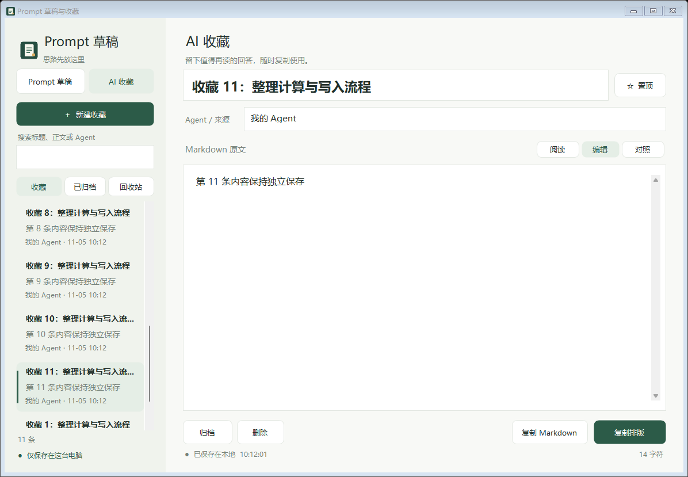

# PromptDraft · Prompt 草稿与收藏

一个轻量、离线的 Windows 草稿工具。先写好 prompt，再复制到 AI 对话；也可以收藏值得保留的回答，阅读和复制 Markdown 排版。

**不需要登录、API Key 或云服务。运行时不联网。** Enter 只是换行，不会发送消息。



## 可以做什么

- 多条独立草稿，为不同 Agent 或对话提前准备内容。
- 按标题、正文和 Agent 搜索；常用内容置顶。
- AI 收藏支持 **阅读 / 编辑 / 对照**，实时预览 Markdown。
- 复制原始 Markdown，或复制排版后的 HTML 与纯文本；阅读区支持选中复制。
- 自动保存、归档、回收站与恢复。
- 记住窗口大小、位置、最大化状态，以及每条内容的光标、选区、滚动位置和视图。
- 数据保存在程序旁边，带上整个文件夹就能移动或备份。

## 开始使用

在 [Releases](https://github.com/mooolei/PromptDraft/releases) 下载 `PromptDraft-v1.2.1-windows.zip`，解压到有写入权限的文件夹，然后双击 `PromptDraft.exe`。如果没有下载包，可以按下面的步骤自行构建。

适用于 Windows 10/11，需 .NET Framework 4.8 或更新的兼容运行时。界面目前为中文。下载包中的程序没有代码签名。

1. 选择 **Prompt 草稿**，点击“新建草稿”，写好后点击“复制全文”。
2. 选择 **AI 收藏**，粘贴回答的 Markdown，使用“阅读”或“对照”查看。
3. 点击标题旁的“☆ 置顶”固定常用内容，再次点击取消。

### 快捷键

| 快捷键 | 功能 |
| --- | --- |
| `Ctrl+N` | 在当前分类中新建 |
| `Ctrl+F` | 搜索 |
| `Ctrl+S` | 立即保存 |
| `Ctrl+Shift+C` | 草稿复制全文；收藏复制排版 |
| `Ctrl+C` / `Ctrl+A` | 阅读区复制所选 / 全选 |
| `Ctrl+Z` | 撤销当前编辑框内的编辑 |

### 数据与升级

首次运行会自动创建 `data/`：

```text
data/
  drafts.json        # 草稿和收藏
  drafts.json.bak    # 上一次保存前的副本
  view-state.json    # 窗口和编辑位置
```

数据是本地明文 JSON。程序不上传内容。更新程序前关闭窗口并备份整个 `data/`，然后替换程序及 DLL，保留原来的 `data/`。发布包不包含任何个人记录。

`.bak` 是单份滚动备份，不是历史版本库；连续保存会更新它。回收站的“彻底删除”不能通过界面撤销，但滚动备份可能暂时仍含旧内容。

## 从源码构建

Windows 自带的 .NET Framework C# 编译器即可使用，不要求安装 Visual Studio。

```powershell
# 从仓库根目录运行（Windows PowerShell 5.1 或 PowerShell 7）
powershell -NoProfile -ExecutionPolicy Bypass -File .\scripts\build.ps1
```

第一次构建会从 NuGet 下载锁定版本的依赖，并按 `dependencies.lock.json` 验证 DLL 的 SHA-256。依赖缓存在 `vendor/`；缓存完整后可离线构建。程序输出到 `.build/app/PromptDraft.exe`。

```powershell
# 不访问网络，只使用已缓存且校验通过的依赖
.\scripts\build.ps1 -Offline

# 核心回归测试，使用临时测试数据
.\scripts\test.ps1

# 额外的 Windows 窗口与剪贴板测试，需要交互式桌面
.\scripts\test.ps1 -Ui

# 生成可分发 ZIP 和 SHA-256 文件
.\scripts\package.ps1
```

UI 测试使用虚构内容和独立数据目录，并会暂时写入剪贴板。测试不读取你的日常草稿。

## 目录

```text
src/                         应用、Markdown 预览、本地存储、界面和位置记忆
assets/                      图标与使用虚构内容的截图
scripts/                     依赖恢复、构建、测试和打包
tests/                       存储、Markdown、复制与侧边栏回归测试
dependencies.lock.json       依赖版本和 DLL 校验值
.github/workflows/build.yml  Windows 构建与核心测试
```

## 当前边界

Markdown 支持标题、列表、任务清单、引用、表格和代码块；暂不渲染数学公式或 Mermaid。外部图片显示为描述文字，预览中的链接不跳转。原始 HTML 不执行。

预览使用 Windows 内置的 WinForms `WebBrowser` 控件，目前仍是旧版 MSHTML 引擎。富文本粘贴效果由接收应用决定；不支持 HTML 的输入框会得到纯文本。

历史版本恢复、Agent 分组筛选、复制为新草稿和长文目录尚未实现。欢迎通过 Issue 讨论或提交 PR。

## 许可证

项目源码采用 [MIT License](LICENSE)。Markdig 与 .NET 依赖保留各自许可证，详见 [THIRD_PARTY_NOTICES.txt](THIRD_PARTY_NOTICES.txt)。

---

**English:** PromptDraft is a small, offline Windows app for drafting AI prompts and saving Markdown answers. It provides independent drafts, search, pinning, rich-text copying, a recycle bin, and per-document view restoration. The UI is currently in Chinese. Build with `scripts/build.ps1`; no API keys or online services are required at runtime.
